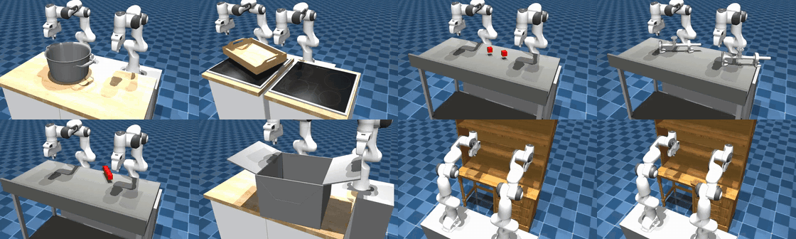
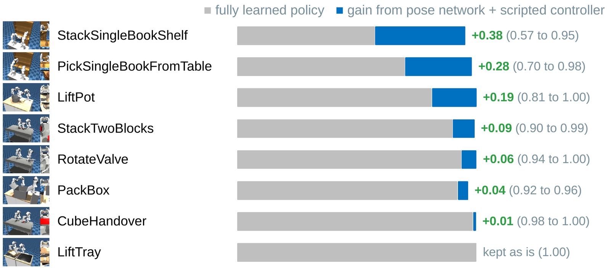
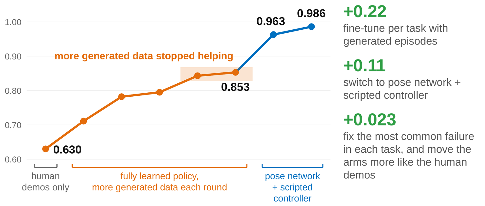
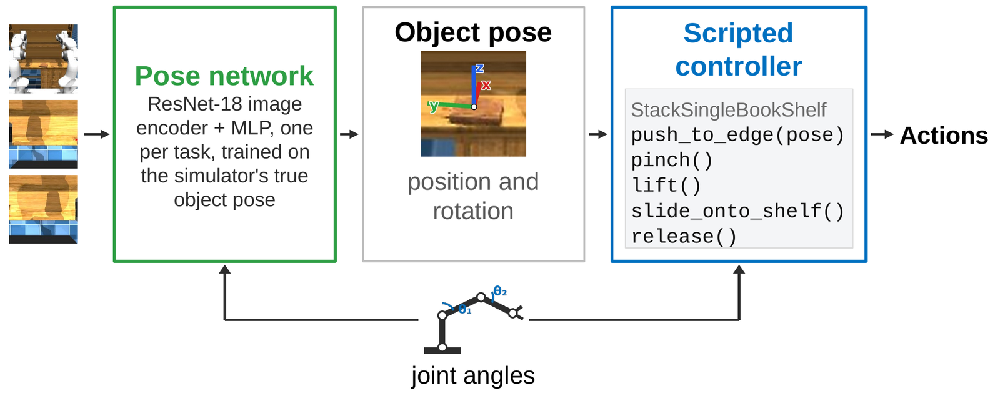

# Metric AI Lab at the CoRL 2026 RoboEval Bimanual Challenge

<p align="center">
  <a href="https://huggingface.co/Metric-AI/roboeval-bimanual-2026"></a>
  <a href="https://robo-eval.github.io/challenge.html"></a>
  <a href="LICENSE"></a>
</p>

2nd place in the [CoRL 2026 RoboEval Diagnostic Bimanual Challenge](https://robo-eval.github.io/challenge.html)
(Track 2), with a RoboEval Diagnostic Score (RDS) of 0.982 on the organizers' 1,000 held-out seeds per task.
Training took 14.8 GPU-hours. The challenge has eight two-arm Franka tasks in simulation.

For seven tasks, a network estimates the object pose from the three cameras and the joint angles, and a scripted
controller moves both arms.

<p align="center"></p>

## Results

Scores on the 50 official seeds per task. On the 1,000 held-out seeds per task used for the final ranking, the RDS
was 0.982.

| Task | Policy | Pose network predicts | Successes | RDS |
|---|---|---|---|---|
| CubeHandover | pose network + scripted controller | rod position and long axis | 50 / 50 | 0.998 |
| LiftPot | pose network + scripted controller | pot position and yaw, handle centres | 50 / 50 | 1.000 |
| LiftTray | fully learned policy | | 50 / 50 | 1.000 |
| PackBox | pose network + scripted controller | box position and yaw, flap angles | 50 / 50 | 0.965 |
| PickSingleBookFromTable | pose network + scripted controller | book position and rotation | 50 / 50 | 0.981 |
| RotateValve | pose network + scripted controller | valve hub positions | 50 / 50 | 1.000 |
| StackSingleBookShelf | pose network + scripted controller | book and shelf position and rotation | 48 / 50 | 0.953 |
| StackTwoBlocks | pose network + scripted controller | block positions and yaw | 50 / 50 | 0.992 |
| **All tasks** | | | **398 / 400** | **0.986** |

<p align="center"></p>

<p align="center"></p>

## Method

<p align="center"></p>

Each pose network (`rdb/hybrid/train_pose.py`) passes every camera image through a ResNet-18 encoder, and an MLP
maps the image features and the joint angles to the object pose. There is one network per task.

Each scripted controller (`policy_bundle/policy/rdb/hybrid/`) plans the end-effector path (approach, grasp, lift, place)
from that pose and follows it with the robot's kinematic model. Objects that stay still until grasped are estimated
once at the start. The books, the box flaps and the handover rod are estimated at every step.

LiftTray runs the fully learned policy (`rdb/model.py`): a ResNet-18 encoder, a transformer and a flow-matching head
that predicts the next 16 actions for both arms. It was trained on the 3,060 human demonstrations and then fine-tuned
on LiftTray with generated episodes.

The training data comes from the same controllers (`rdb/gen/`), run with the simulator's true object pose instead of
the estimate. They produced 8,043 episodes for the fully learned policy and the labelled camera frames for the pose
networks.

## Setup

You need [RoboEval](https://github.com/Robo-Eval/RoboEval) at tag `corl2026-challenge` and Python 3.10+.

```bash
git clone https://github.com/Metric-AI-Lab/roboeval-bimanual-2026 && cd roboeval-bimanual-2026
pip install -r requirements.txt
bash scripts/download_weights.sh        # 1.3 GB into policy_bundle/checkpoint/
```

## Evaluation

```bash
# all 8 tasks, 50 episodes each, W parallel workers
MUJOCO_GL=egl python -m roboeval.challenge.evaluate --submission policy_bundle --workers W --gpus 0 \
    --output-dir runs/eval
```

## Training

The final models took 14.8 GPU-hours to train.

**1. Human demonstrations.** Convert the RoboEval demonstrations (`helen9975/roboeval_ee_delta_20hz_scaled`):

```bash
python -m rdb.prep --src ../datasets/roboeval_ee_delta_20hz_scaled --out data/s128 --size 128 --procs 8
```

**2. Generated episodes.** Run a task's scripted controller on a seed range and keep the successful episodes. For
example, LiftTray:

```bash
MUJOCO_GL=egl python -m rdb.gen.scripted_lift_tray_h --seeds 106000:106700 --out data/gen/scripted_h
python -m rdb.gen.build_data --base data/s128 --gen data/gen --sources scripted_h --out data/s128_v2
```

**3. Fully learned policy.** Train a general model on all human demonstrations, then fine-tune it on LiftTray:

```bash
python -m rdb.train --data data/s128 --out runs/general --steps 120000 --lr 5e-5
python -m rdb.train --data data/s128_v2 --out runs/lift_tray --init runs/general/policy_last.pt \
    --variants LiftTray,LiftTrayOrientation,LiftTrayPosition,LiftTrayPositionAndOrientation --steps 20000
```

**4. Pose networks.** Render camera frames labelled with the true object pose, then train one network per task:

```bash
MUJOCO_GL=egl python -m rdb.hybrid.pose_data                                     # LiftPot
MUJOCO_GL=egl python -m rdb.hybrid.reset_pose_data --task blocks --count 5000    # StackTwoBlocks, RotateValve
MUJOCO_GL=egl python -m rdb.hybrid.box_pose_data --first-seed 2263000 --count 500 --out data/hybrid/box_traj/a
MUJOCO_GL=egl python -m rdb.hybrid.book_pose_data --task PickSingleBookFromTable --policy ctl
MUJOCO_GL=egl python -m rdb.hybrid.handover_pose_data
python -m rdb.hybrid.train_pose --data data/hybrid/pot --labels pot_xyz pot_yaw handle_centres --out runs/hybrid/pot_pose
```

The final networks used these labels and step counts:

| Task | `--labels` | Steps |
|---|---|---|
| CubeHandover | `rod_xyz rod_quat_wxyz:axisy` | 19,000 |
| LiftPot | `pot_xyz pot_yaw handle_centres` | 6,000 |
| PackBox | `box_xyz box_yaw:2 flap0_rem flap1_rem` | 4,000 |
| PickSingleBookFromTable | `book_xyz book_quat_wxyz` | 10,000 |
| RotateValve | `hubA_xyz hubB_xyz` | 4,000 |
| StackSingleBookShelf | `book_xyz book_quat_wxyz shelf_xyz shelf_quat_wxyz` | 5,000 |
| StackTwoBlocks | `blkA_xyz blkA_yaw:4 blkB_xyz blkB_yaw:4` | 6,000 |

## License

The code and the weights are released under the Apache License 2.0.

## Acknowledgements

This project uses [RoboEval](https://github.com/Robo-Eval/RoboEval) (benchmark, simulator, demonstrations and
evaluator) and [MuJoCo](https://mujoco.org). The robot model in `rdb/hybrid/book_robot_model.py` and the scene sizes
in the controllers are read from RoboEval's assets.
